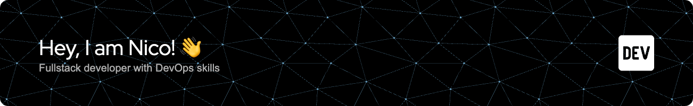
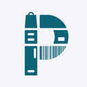

I build web and mobile apps with Angular, Ionic and NestJS, run them on my own Kubernetes cluster, and work with Claude Code and MCP every day.

[nicolueg.com](https://nicolueg.com) · [LinkedIn](https://www.linkedin.com/in/nico-lueg-92907aa3/) · [kubernanny.app](https://kubernanny.app) · [pantrist.com](https://www.pantrist.com)

-  **[Kubernanny](https://github.com/kubernanny/kubernanny)**: open-source health checks for self-hosted Kubernetes, as an app for iOS, Android and web
-  **[Pantrist](https://github.com/Pantrist-dev)**: pantry, shopping list and meal planning app with AI features and an [MCP server](https://github.com/Pantrist-dev/pantrist-mcp) for Claude
- 🤖 **RKE2 cluster**: three self-hosted nodes run all of the above, deployed with Argo CD, Helm and OpenTofu
- 🛠️ **Reparo**: offline-first order management app for a local roofer

          
